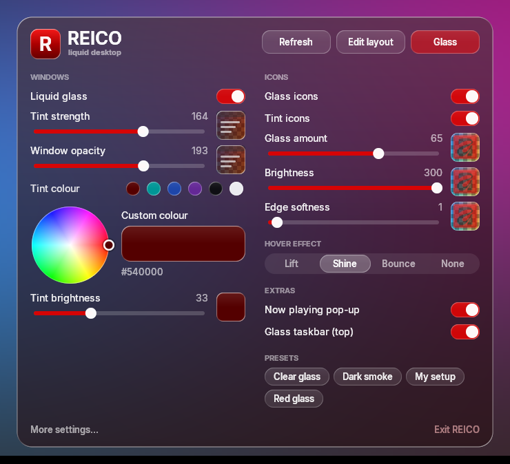
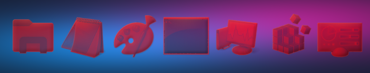
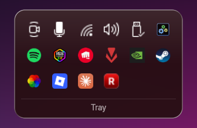
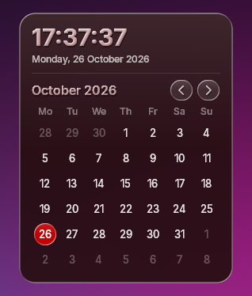
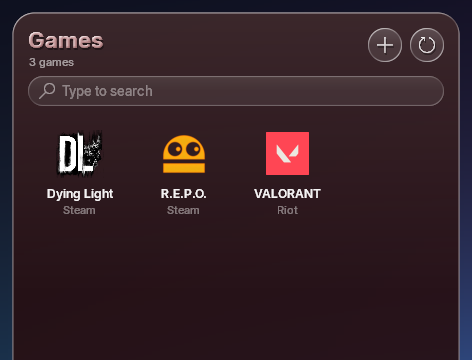
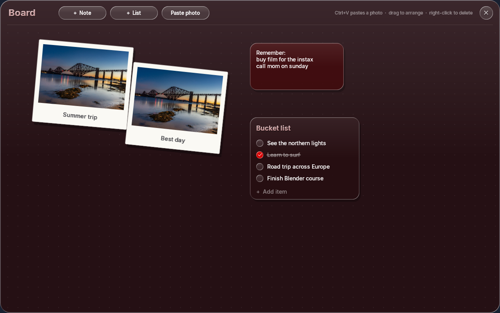
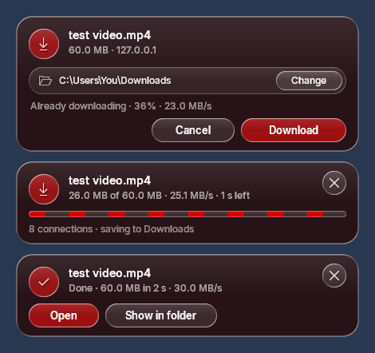
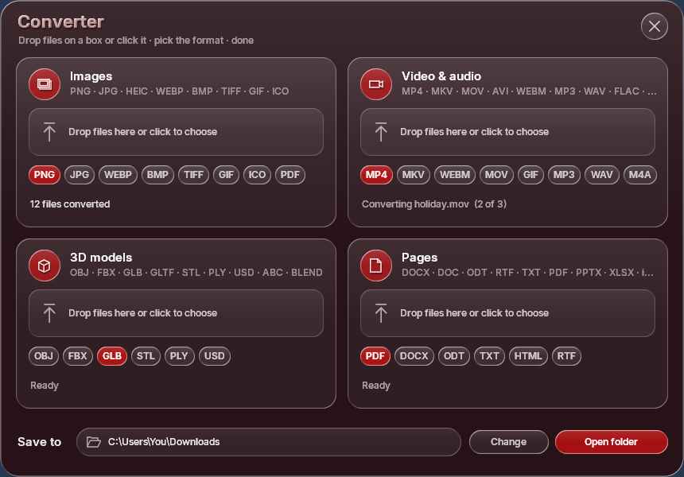
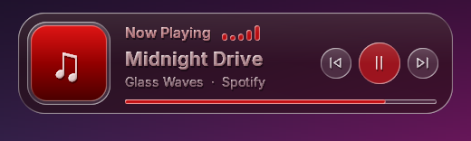

<p align="center">
  
</p>

<h1 align="center">REICO</h1>
<p align="center"><b>iOS-style Liquid Glass / glassmorphism desktop for Windows 10</b><br>
Frosted, translucent, tinted glass for windows, desktop icons and the taskbar, plus a glass now-playing widget, a game launcher, a photo/notes board, a fast multi-connection download manager and an all-in-one file converter, all in one small app.</p>

<p align="center">
  <a href="../../releases/latest/download/REICO.zip"><b>⬇ Download REICO (latest)</b></a> ·
  <a href="../../releases/latest">All releases</a>
</p>

---

REICO brings Apple's **Liquid Glass** look from **iOS 26** and macOS to Windows: a full **glassmorphism** desktop theme. Everything becomes translucent, tinted **frosted glass** with a bright rim of light and a soft gloss, in a single colour of your choice: File Explorer windows, desktop icons, a **translucent glass taskbar / dock**, the tray, the calendar, a now-playing music widget and a game launcher. If you're **ricing** Windows 10 and want an iPhone-like glass UI, this does it in one app. It is one small native program (about 2 MB, plain Win32 + C++), uses around **50 MB of RAM**, and sits at **~0% CPU** when idle.

> **Windows 10 (64-bit).** Windows 11 hasn't been tested.

## Contents

- [Features](#features)
- [Install](#install)
- [Using REICO](#using-reico)
- [Settings](#settings-glasstxt)
- [Build from source](#build-from-source)
- [Uninstall](#uninstall)
- [Good to know](#good-to-know)
- [Credits & license](#credits--license)

## Features

### 🪟 Liquid-glass windows
File Explorer windows (or any window type you choose) become clear, tinted glass with a light rim and gloss. The tint is cut exactly to the window's edge, with no colour bleeding past it. Turn it on or off any time with **Ctrl+Shift+F6**.

### 💧 Liquid animations
REICO's windows don't just fade in; they **pour out of the button that opened them**. A glass drop beads on the button, stretches away on a liquid bridge that thins and snaps, then swells into the window with a soft spring and a jelly wobble while its content fades in. Closing pours it back in. It works for the game launcher, board, converter, tray, calendar and the glass panel. Frames are spread across your CPU cores (about 5 ms each). Switch it off in the panel (**Liquid animations**) for plain fades.

### 🧊 Glass desktop icons
Your desktop icons are redrawn as glass in your tint: a frosted body, a specular edge, a darker thickness edge and a top gloss. A slider controls how much glass versus the original icon you see. Icons can be moved and resized, and the layout is saved.

<p align="center"></p>

### 📌 Glass taskbar (dock)
A rounded glass bar centred at the top of the screen replaces the Windows taskbar. It has:
- **Start**
- your **pinned** and **open apps**, grouped by app, with a glass pill under the active one and a shine sweep on hover
- a **tray** button
- a **clock**

Maximized windows stop below it, and it hides itself for fullscreen games and videos. While it's on, the Windows taskbar is hidden. Your original taskbar setting is restored when you turn the dock off or close REICO.

<p align="center"></p>

<table>
<tr>
<td align="center"><br><b>Tray</b><br>All your tray icons, each shown once. Left- and right-clicks reach the app exactly like the real tray.</td>
<td align="center"><br><b>Calendar</b><br>A live clock with seconds and a month view. Use the arrows, the mouse wheel or ← → to change month.</td>
</tr>
</table>

### 🎮 Game launcher
The round **controller** button at the top-left opens a glass grid of your games:
- **Finds games from:**
  - **Steam** (all library folders)
  - **Epic Games**
  - **Riot** (VALORANT, League, on any drive)
  - **GOG**
  - **`Games` folders** on every drive
  - the **EA, Ubisoft and Rockstar** install folders
- **⟳** re-scans. Nothing scans automatically.
- **＋** adds any game exe the scan missed.
- **Right-click** a game to remove it.
- **Typing** searches, and **Enter** launches the top match.

Store games launch through their own launcher, so updates and overlays keep working.

<p align="center"></p>

The button next to it opens **Task Manager**.

### 📸 The board: photos, notes and bucket lists
The third round button opens a big glass **board**, a moodboard and to-do space in one:
- **Photos:** paste any picture with **Ctrl+V** (copied from a browser, a screenshot, or an image file in Explorer). It lands as an **Instax-style polaroid print**, tilted, with a white frame and a soft shadow. Click it and type to caption it.
- **Notes:** **+ Note** adds a glass sticky note to type in.
- **Bucket lists:** **+ List** adds a checklist. Type and press Enter to add things, click the circle to tick them off.

Drag everything around freely and right-click to delete. Click a list's title to rename it. Drag the board's top bar to move the whole board. It all saves automatically to `C:\REICO\board`.

<p align="center"></p>

### ⚡ Download manager (faster browser downloads)
A built-in **download accelerator**, in the spirit of IDM, for **Chrome, Edge and Brave**. With the small **REICO Downloads** extension installed (see [Install](#install)), every download you start in the browser goes to REICO instead:
- A glass card asks **where to save it**, with **Change** to pick a folder and **Download / Cancel** to confirm. The download **already starts in the background** while the card waits, so no time is lost.
- It downloads with **8 connections at once** using HTTP byte ranges. Many servers and CDNs cap the speed of each connection, and one connection rarely fills a fast line, so several in parallel add up.
- **Dynamic splitting**, as IDM does it: when a connection finishes its part, it takes over the second half of the biggest part still left. There's no slow tail at the end, and the progress bar shows every connection's part filling in.
- **Self-healing:** a connection that stalls or drops resumes from the exact byte it stopped at. If a server refuses extra connections (HTTP 429/503), REICO simply uses fewer, and connections are kept alive between parts.
- It sends your browser cookies, referrer and user agent along, so downloads that need you to be logged in still work.
- Files download as `name.reico-part` and only get their real name once complete. Cancelled or failed downloads delete themselves, even if REICO is closed mid-way.
- When it's done: **Open** or **Show in folder**.

In a local test where each connection was capped at 3 MB/s (as many CDNs do), a 60 MB file took **20 s** as a normal single-connection download and **2.9 s** with REICO, about **7× faster**. How much faster it is for you depends on the server: on a server that doesn't limit connections and a line that is already full, it can't go faster than your internet.

Files under 1 MB, private/incognito windows and `blob:` downloads stay with the browser. Turn the whole thing off in the panel (**Download manager**), and the browser downloads normally again.

<p align="center"></p>

### 🔁 Converter: images, video, 3D models and documents
The ⇄ button at the top-left opens a glass converter with four boxes. **Drag files onto a box** (or click it to pick them), choose the output format on its chips, and they're converted into the **Save to** folder at the bottom. Drop as many files as you like: they're converted one after another.

| Box | Converts to | Reads |
|---|---|---|
| **Images** | PNG, JPG, WEBP, BMP, TIFF, GIF, ICO, PDF | PNG, JPG, HEIC, WEBP, BMP, TIFF, GIF, ICO… |
| **Video & audio** | MP4, MKV, WEBM, MOV, GIF, MP3, WAV, M4A | almost any video or audio file |
| **3D models** | OBJ, FBX, GLB, STL, PLY, USD | OBJ, FBX, GLB/GLTF, STL, PLY, USD, ABC, BLEND |
| **Pages** | PDF, DOCX, ODT, TXT, HTML, RTF | DOCX, DOC, ODT, RTF, TXT, PDF, PPTX, XLSX… and images → PDF |

**How it works:**
- **Images** are converted inside REICO with Windows' own image codecs. Transparency is kept for PNG, WEBP, TIFF and ICO; JPG, BMP and GIF get a white background.
- The other boxes use free tools. Each tool runs **hidden in the background** (no window, not even a splash screen) at **below-normal priority**, one file at a time, and **closes itself as soon as the file is written**. If you close REICO mid-way, they stop too.
  - **ffmpeg** for video and audio (and WEBP).
  - **Blender** in background mode for 3D models. Expect about 4 s per file while Blender starts.
  - **LibreOffice** in headless mode for documents.
- If a tool is missing, its box shows an **Install** button that installs it with winget. Pictures → PDF works without LibreOffice.

<p align="center"></p>

### 🎵 Now playing
When a song starts, changes or pauses, a glass card drops in at the top of the screen for 5 seconds. It shows the album art, the title and artist in glass lettering, bouncing glass beat bars, and **previous / play-pause / next** buttons. It works with any app that shows in the Windows volume flyout: Spotify, browsers and more. Hovering the card pauses its countdown.

<p align="center"></p>

### 🎛️ The glass panel
Left-click REICO's tray icon to open the panel:
- tint **colour wheel** and colour swatches
- tint strength, window opacity and tint brightness
- icon glass amount, brightness and edge softness, each with a **live preview** next to its slider
- hover effects: **Lift / Shine / Bounce / None**
- Extras: now-playing pop-up, glass taskbar, each top-left button (games, Task Manager, board, converter) and the download manager on/off
- drag the panel's top bar to move it anywhere
- **presets** (Red glass, Clear glass, Dark smoke, and your own)

Every change applies live, and REICO's own icon recolours with your tint.

## Install

1. **[Download REICO.zip](../../releases/latest/download/REICO.zip)**.
2. Extract it to **`C:\REICO`**. REICO keeps its settings there, so the folder name matters. You should end up with `C:\REICO\REICO.exe` and `C:\REICO\fonts\`.
3. Run **`REICO.exe`**.

That's it. REICO starts with Windows from then on. Its settings files are created automatically on first run.

**For the download manager** (optional, Chrome / Edge / Brave):

4. Open `chrome://extensions` (Edge: `edge://extensions`, Brave: `brave://extensions`).
5. Turn on **Developer mode**, click **Load unpacked** and choose **`C:\REICO\extension`**.

REICO registers itself with the browser when it starts, so run REICO at least once first. Firefox isn't supported.

> Windows SmartScreen may warn about an unrecognised app, because the exe isn't code-signed. Choose **More info → Run anyway**, or [build it yourself](#build-from-source).

## Using REICO

| Where | What |
|---|---|
| Tray icon — **left-click** | Glass panel (all settings) |
| Tray icon — **right-click** | Menu: settings, presets, glass on/off, edit icon layout, rescan, open `glass.txt`, exit |
| Dock — **click an app** | Open it, switch to it, or minimize it if it's already in front |
| Dock — **middle-click / right-click** | New window / menu (new window, close) |
| Desktop icon — **double-click** | Launch it |
| **F2** (desktop focused) / panel → *Edit layout* | Edit mode: drag icons to move them, drag the corner handle to resize |
| **Ctrl+Shift+F5** | Rescan the desktop icons |
| **Ctrl+Shift+F6** | Window glass on/off |

## Settings (`glass.txt`)

Everything in the panel is stored in `C:\REICO\glass.txt`. You can also edit it in Notepad; REICO picks up changes within a second.

| Setting | Meaning |
|---|---|
| `tint=R,G,B` | Glass colour |
| `tintAlpha` | Tint strength, 0–255 |
| `windowAlpha` | Window opacity, 80–255 |
| `liquid` | 1 = liquid glass, 0 = classic blur/acrylic (`mode=blur` or `acrylic`) |
| `radius` | Rounded corners in px. **Keep 0 on Windows 10**: Windows draws Explorer's title bar square |
| `iconGlass`, `iconGlassAmount` | Glass icons on/off, and % glass vs. the original icon |
| `iconTint`, `iconBrightness`, `iconEdgeBlur` | Tint icons, their brightness, and edge softness |
| `hoverEffect` | `lift`, `shine`, `bounce` or `none` |
| `nowPlaying` | Now-playing pop-up on/off |
| `dock` | Glass taskbar on/off |
| `btnGames`, `btnTaskMgr`, `btnNotes`, `btnConvert` | The round buttons at the top-left on/off |
| `liquidAnim` | Windows pour out of their buttons (1) or just fade (0) |
| `downloads` | Download manager on/off (1 = REICO takes browser downloads) |
| `class=` | Which window types get glass (one per line). Default `CabinetWClass` = File Explorer |

Presets are copies of `glass.txt` in `C:\REICO\presets\`. Applying a preset only changes the settings it contains.

## Build from source

You need [MSYS2](https://www.msys2.org/) with the UCRT64 GCC toolchain (`pacman -S mingw-w64-ucrt-x86_64-gcc`). Then, in an MSYS2 UCRT64 shell:

```bash
cd /c/REICO
windres reico.rc -O coff -o reico.res
g++ main.cpp reico.res -municode -mwindows -O2 -s -static -o REICO.exe -lshell32 -lwinhttp
```

Or double-click `build.bat`. The result is a single, fully static `REICO.exe`.

The whole app is one file, `main.cpp`, plus the browser extension in `extension/`. Apart from WinHTTP (for the download manager), everything (DWM, WinRT media session, comctl32, comdlg32 and so on) is loaded at runtime, so no extra libraries are needed.

## Uninstall

1. Right-click the REICO tray icon → **Exit REICO**. This also restores the Windows taskbar.
2. Task Manager → **Startup** → disable **REICO**, or delete `HKCU\Software\Microsoft\Windows\CurrentVersion\Run\REICO`.
3. If you added the extension: remove **REICO Downloads** from your browser's extensions page, and delete the `com.reico.downloads` keys under `HKCU\Software\Google\Chrome\NativeMessagingHosts`, `HKCU\Software\Microsoft\Edge\NativeMessagingHosts` and `HKCU\Software\BraveSoftware\Brave-Browser\NativeMessagingHosts`.
4. Delete `C:\REICO`.

## Good to know

- **Antivirus:** to show your tray icons in its glass tray, REICO reads the icon list from Explorer's tray, the same way tray tools have always done it. Together with being unsigned, a few antivirus programs may flag it. The full source is here if you want to check, or build it yourself.
- **Built for Windows 10.** The glass on windows uses an undocumented Windows API that many tools use. It could change in future Windows updates.
- The dock shows on the main monitor.
- Apps that draw their own title bar (e.g. Chrome) keep their own look.
- **Blender bonus:** `reico_autoscale.py` is a small Blender add-on that scales Blender's UI with its window size. Install it in Blender via *Preferences → Add-ons → Install from Disk*.

## Keywords

liquid glass · iOS 26 liquid glass for Windows · glassmorphism · glass UI · polaroid / instax photo board · moodboard · sticky notes · bucket list · to-do checklist · frosted glass · translucent taskbar · transparent taskbar · glass dock · macOS-style dock · iPhone-style icons · tinted icons · acrylic · Windows 10 customization · Windows 10 theme · desktop customization · ricing · rice · aesthetic desktop · Rainmeter alternative · TranslucentTB alternative · now playing widget · Spotify widget · game launcher · download manager · download accelerator · IDM alternative · Internet Download Manager alternative · multi-connection downloader · segmented download · Chrome download manager · liquid animation · gooey animation · file converter · image converter · HEIC to JPG · video converter · MP4 to MP3 · 3D model converter · FBX to GLB · OBJ to STL · DOCX to PDF · ffmpeg GUI · Win32 · C++

## Credits & license

- UI font: [Inter](https://rsms.me/inter/) by Rasmus Andersson, SIL Open Font License (see `fonts/Inter-LICENSE.txt`).
- REICO is released under the MIT License (see `LICENSE`).
